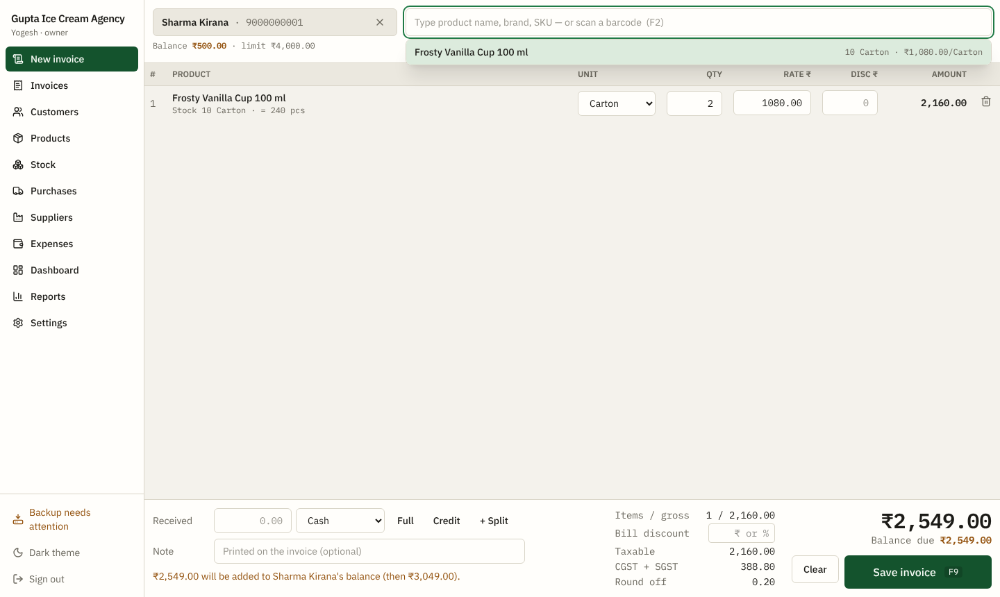
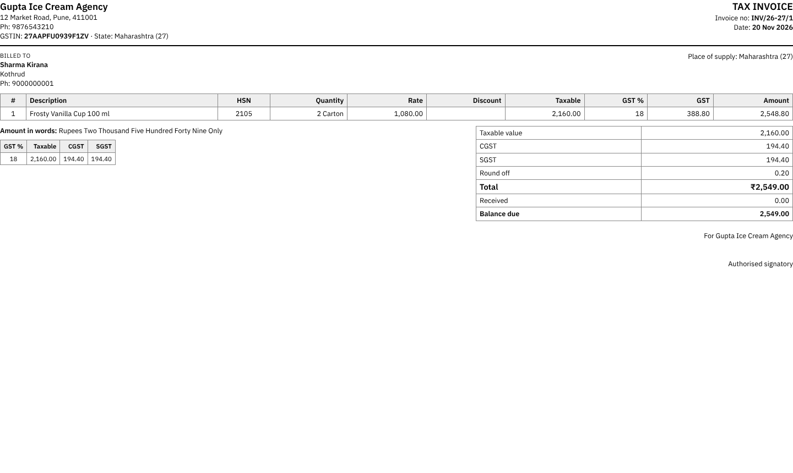
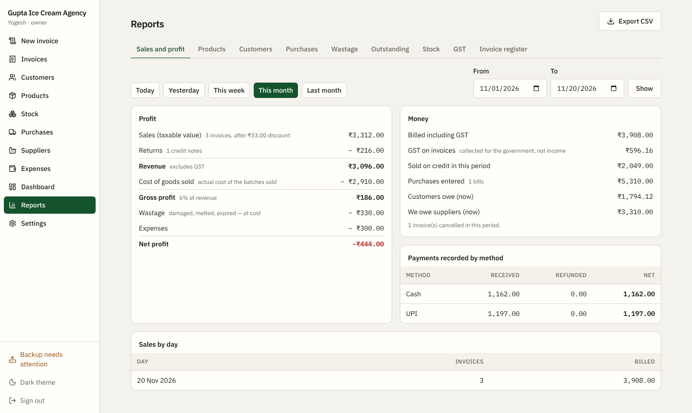
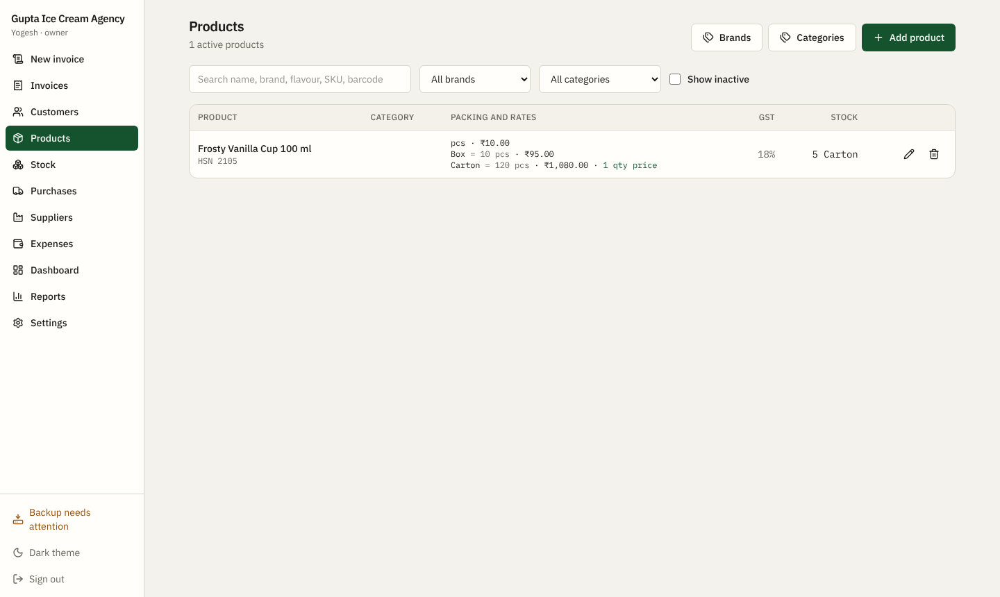
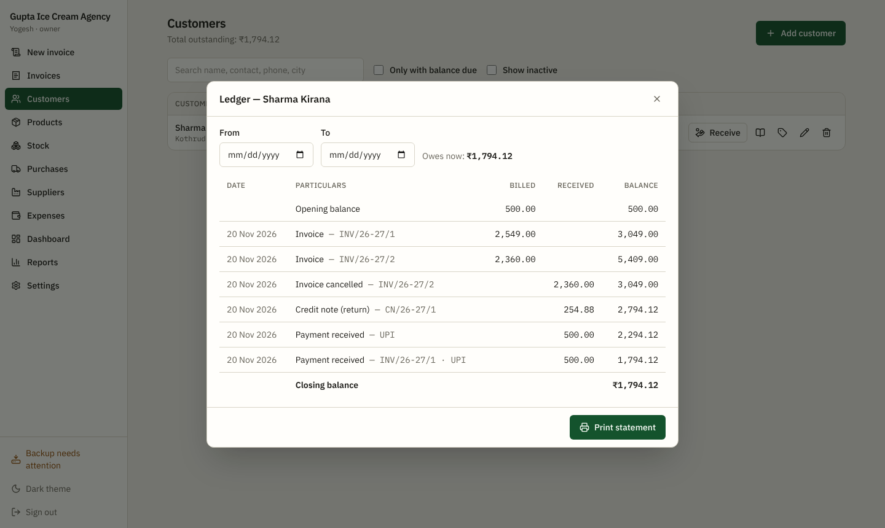

# YG POS

**Offline billing, stock and accounts software for a wholesale ice cream distributor in India.**

YG POS is a Windows desktop application. It runs entirely on one computer and keeps all of its
data in a local database file. It needs no internet connection, no server and no online account.

It was built for one real business (a single billing computer, wholesale customers, GST
invoices) and is shared here so others can see how it works and learn from it.



## Who it is for

Wholesale distributors who:

- sell the same product in several packings (piece, box, carton) and need stock to stay correct
  whichever one they sell;
- give customers credit and need to know who owes what;
- issue GST tax invoices;
- want billing to keep working when the internet is down — because it never needs it.

It is **not** a supermarket checkout, an online store, or a multi-branch system. It does not
process payments: cash, UPI, card and bank payments are recorded, not collected.

## Features

| Area | What it does |
| --- | --- |
| **Invoices** | Keyboard-first wholesale invoice screen. Pick the customer, type a product, choose box or carton, enter the quantity. Final invoice number at once (`INV/26-27/1`), restarting each financial year |
| **Packing units** | Each product is counted in its smallest unit (piece, cup, kg…). Boxes and cartons are set per product, e.g. 1 carton = 12 boxes = 120 pieces. Selling 2 cartons takes 240 pieces from stock |
| **Pricing** | A rate per packing unit, quantity prices ("₹1,050 a carton from 5 cartons"), special rates per customer. A hand-typed rate needs an owner or manager |
| **Customer credit** | Paid, part-paid and credit invoices; credit limits; opening balances; payments applied to the oldest dues first; a ledger and printable statement per customer |
| **Stock** | Batches with expiry dates, oldest expiry sold first, expired stock blocked from sale; write-offs for damaged, melted and expired goods; stock counts and full history |
| **Purchases** | Supplier bills add stock with batch, expiry and true cost; supplier balances, payments and ledgers |
| **Returns** | Cancel an invoice, or return part of it — even part of a carton — against a credit note. Returned goods go back on sale or into wastage |
| **GST** | Optional. GSTIN with check-digit validation, CGST + SGST or IGST by customer state, a rate and HSN code per product, rates before or including GST |
| **Printing** | A4 tax invoice (with amount in words), 58/80 mm thermal receipt, PDF export, choice of printer |
| **Reports** | Revenue, gross profit, wastage, expenses and net profit; sales by product and customer; purchases; who owes what; stock value; GST summary by rate and HSN; invoice number register; CSV export |
| **Users** | Owner, manager and cashier logins with different permissions, and an audit log |
| **Backups** | Automatic, verified backups to the computer and to a second drive; restore in a few clicks, with a safety copy of the data being replaced |

| | |
| --- | --- |
|  |  |
|  |  |

*Screenshots use made-up demo data.*

## Status

In daily use by the business it was built for. See [CHANGELOG.md](CHANGELOG.md) for versions.

- All business rules, the interface and the desktop app are covered by automated tests, which run
  on Windows and Linux for every change.
- **The GST handling has not been reviewed or certified by a tax professional.** If you use it,
  have your accountant check an invoice and the GST report. E-invoicing, e-way bills and the
  composition scheme are not supported.
- The Windows installer is not code-signed, so Windows shows an "unknown publisher" warning.

Not included: online payments, multiple branches, freezer-wise stock, product import from Excel,
returns to suppliers, customer advance payments.

## Trying it

### Install on Windows

Windows 10 or 11, 64-bit.

1. Open the [latest release](https://github.com/Yogesh1017/YG_POS/releases/latest) and download
   `YG-POS-Setup-<version>.exe`.
2. Run it. The installer is not code-signed, so Windows shows an "unknown publisher" warning:
   choose **More info → Run anyway**.

Installing a newer version over an older one keeps all data. Each release also lists a SHA-256
checksum (`SHA256SUMS.txt`) for checking the download.

### First run

1. Create the owner login and enter the business details. Tick GST only if the business has a GSTIN.
2. **Write down the recovery key** shown next. It is the only way to reset a forgotten owner password.
3. **Settings → Backup and restore:** choose a second backup location on a USB or external drive.
4. **Settings → Printing:** pick the A4 and thermal printers (install them in Windows first).
5. **Settings → Users:** add logins for staff.
6. Add products with their packing and rates, then customers and suppliers. Enter existing stock
   and balances as opening figures.

### Keyboard

| Key | Does |
| --- | --- |
| F1 | New invoice, from any screen |
| F3 | Customer box |
| F2 | Product search (a barcode scanner works here too) |
| Enter | Add the highlighted product; from the quantity box, back to product search |
| Tab | Move across quantity, rate and discount |
| F9 or Ctrl+Enter | Save the invoice |

### Where the data lives

- Database: `%APPDATA%\YG POS\data\ygpos.db` (also reachable from **Help → Open data folder**).
- Backups: the `backups` folder beside it, and the second location chosen in Settings.
- Uninstalling the app does not delete the data.

Backups are taken when the app opens, every two hours while it is open, and when it closes. Each
one is checked after it is written. [ARCHITECTURE.md](ARCHITECTURE.md#backup-and-recovery)
explains restoring, including moving to a new computer.

## Building from source

Requires Node.js 22.13 or newer.

```bash
npm install
```

```bash
npm run build
```

```bash
npm start
```

`npm start` opens the desktop app. To run it in a browser instead (no desktop shell), use
`npm run serve` and open http://127.0.0.1:3210; data goes to `.data/`.

Build the Windows installer (on Windows):

```bash
npm run dist
```

### Publishing a release

1. Set the new version in `package.json` and add a matching `## <version>` section to `CHANGELOG.md`.
2. Merge to `main`.
3. On GitHub: **Actions → Release → Run workflow** (on `main`). It runs the tests, builds the
   installer on Windows, and publishes it as a release using that changelog section as the notes.

### Tests

```bash
npm run lint
```

```bash
npm run typecheck
```

```bash
npm test
```

```bash
npm run test:e2e
```

```bash
npm run test:desktop
```

`npm test` runs the core tests (business rules, database, backup and restore). The last two need
a build and Playwright (`npm install --no-save playwright` then `npx playwright install chromium`).
On Linux without a display, run the desktop test as `xvfb-run -a npm run test:desktop`.

### How it is built

Electron desktop shell · Next.js and React interface, exported as static files · business rules in
a TypeScript core · SQLite through Node's built-in `node:sqlite` (no native add-ons). Money is
stored in whole paise and quantities in whole thousandths, so there is no floating-point arithmetic.

| Document | Covers |
| --- | --- |
| [ARCHITECTURE.md](ARCHITECTURE.md) | Design, how an invoice is saved safely, roles, printing, backup and recovery |
| [DATABASE_SCHEMA.md](DATABASE_SCHEMA.md) | Tables, units, rules the database enforces, migrations |
| [API_DOCUMENTATION.md](API_DOCUMENTATION.md) | Every operation the interface can ask the core to do, and who may do it |
| [PROJECT_PLAN.md](PROJECT_PLAN.md) | Decisions taken, feature checklist, what is left |
| [CHANGELOG.md](CHANGELOG.md) | Versions |

```
desktop/core/   business rules and database      desktop/   Electron shell, request handler
src/            interface (screens, invoice layouts, shared arithmetic)
tests/          core tests                       e2e/       browser and desktop-app tests
archive/        an earlier, retired web version (see below)
```

### About the `archive/` folder

The project started as a browser app for a retail shop that stored data online (Supabase). It was
then rebuilt as the offline wholesale desktop app you see here. The first version is kept in
`archive/web-supabase-v0.1/` for reference only; nothing in it is used, and it is not maintained.

## License

[MIT](LICENSE). You may use, change and share this software, including commercially, as long as
the copyright and license notice are kept. It comes with no warranty — in particular, check its GST
handling with a tax professional before relying on it.
